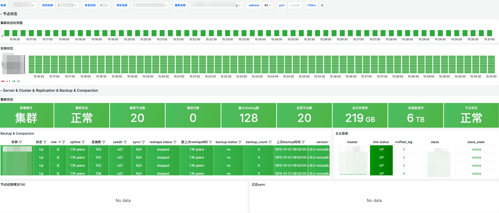
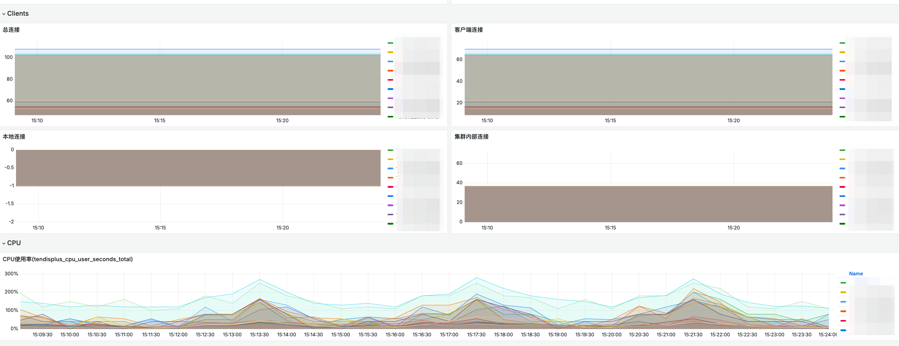
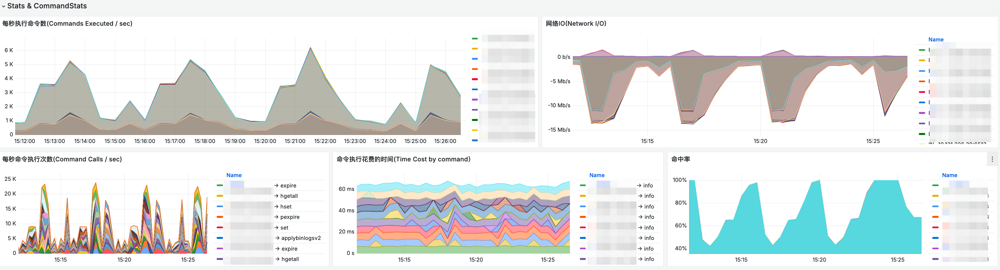
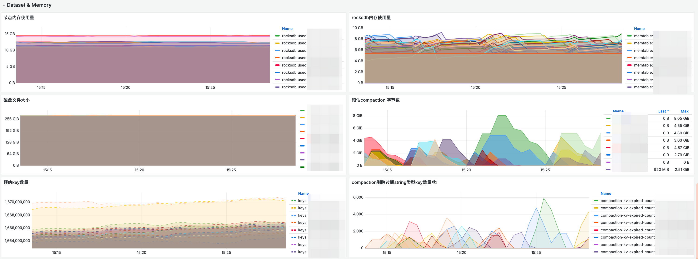
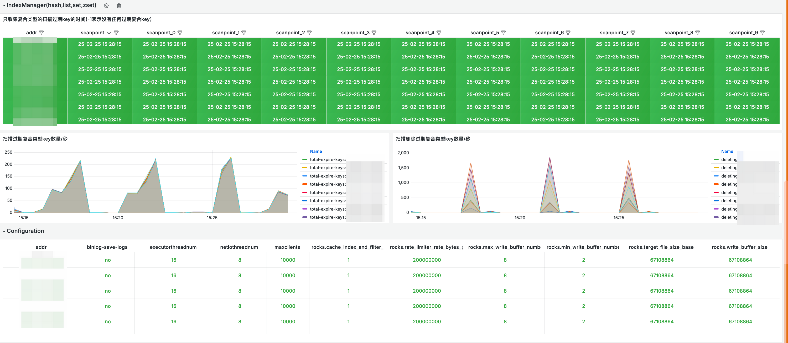

### 编译及运行

```sh
git clone https://github.com/zhaochunxue/tendisplus_exporter.git
cd tendisplus_exporter
go build -o tendisplus_exporter -ldflags  "-s -w -extldflags \"-static\" -X main.BuildVersion=v1.62.1 -X main.BuildDate=2025-02-20"

./tendisplus_exporter --version

若使用镜像已经打好了docker包,可直接下载tendisplus_exporter.tar
docker load -i tendisplus_exporter.tar 即可加载镜像
```

### 版本改动说明
```sh
此版本是由redis_exporter:v1.62.1改造而成,与redis_exporter使用方式相同,不懂的可先移步redis_exporter [https://github.com/oliver006/redis_exporter]

主要变动:
1.REDIS_ADDR 支持配置多个节点 如: 127.0.0.1:6379,127.0.0.1:6380,127.0.0.1:6381
2.添加了tendis中的info信息作为监控指标, 除 info levelstats ,info rocksdberror 外基本都有

```


### 面板展示

Example [Grafana](http://grafana.org/) screenshots:







